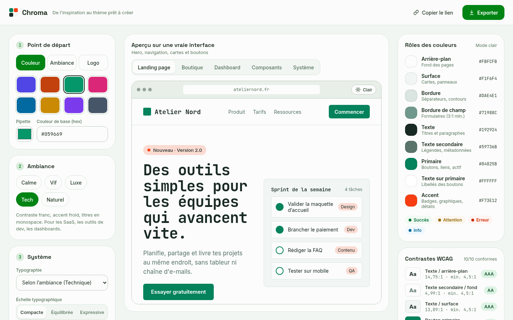

# Chroma

**Une couleur → un design system complet, accessible par défaut.**

Chroma génère, à partir d'une couleur, d'une ambiance ou d'un logo, un thème clair et sombre qui respecte les contrastes WCAG, le montre sur de vraies interfaces et l'exporte prêt à coller dans un projet React + Tailwind, Next.js ou HTML/CSS, avec un kit de composants.

Tout tourne dans le navigateur : aucune couleur n'est envoyée à un serveur.



---

## Sommaire

- [Ce que Chroma génère](#ce-que-chroma-génère)
- [Démarrer](#démarrer)
- [Utiliser un thème exporté](#utiliser-un-thème-exporté)
- [Fonctionnement](#fonctionnement)
- [Structure du projet](#structure-du-projet)
- [Limites connues](#limites-connues)
- [Contribuer](#contribuer)
- [Licence](#licence)

## Ce que Chroma génère

| | |
|---|---|
| **Couleurs** | 9 rôles par mode (fond, surface, bordure, bordure de champ, texte, texte secondaire, primaire, texte sur primaire, accent), plus le survol et les variantes douces |
| **Nuances** | 7 palettes de 50 à 950 (primaire, accent, neutre, succès, attention, erreur, info), calculées en OKLCH |
| **États** | Succès, attention, erreur, info : couleur pleine, couleur de texte associée, fond doux |
| **Typographie** | 6 paires de polices (Google Fonts), échelle compacte / équilibrée / expressive, interlignes |
| **Espacements, arrondis, ombres** | Échelle d'espacement réglable (densité), 4 rayons, 4 ombres teintées |
| **Composants** | 17 composants : bouton, champ, liste, zone de texte, case, radio, interrupteur, badge, alerte, carte, onglets, tableau, avatar, progression, modale, notification… |
| **Contrastes** | 10 paires vérifiées et ajustées automatiquement en clair **et** en sombre |

Chaque thème est visible sur cinq aperçus : une landing page, une boutique, un dashboard, le kit de composants et la planche du système.

### Formats d'export

| Format | Fichier | Pour |
|---|---|---|
| CSS | `theme.css` | Tout projet, HTML/CSS compris |
| Tailwind v4 | `globals.css` | React + Tailwind, Next.js |
| Tailwind v3 | `tailwind.config.js` | Projets Tailwind v3 (avec `theme.css`) |
| shadcn/ui | `app/globals.css` | Next.js avec shadcn/ui |
| Figma | `chroma.tokens.json` | Format W3C Design Tokens |
| Composants CSS | `components.css` | Styles de base + classes `ui-*` |
| Composants React | `components/ui.tsx` | Composants typés (React, Next.js) |

## Démarrer

Prérequis : **Node.js 20** ou plus récent.

```bash
cd app
npm install
npm run dev
```

- Landing page : <http://localhost:5173/>
- Générateur : <http://localhost:5173/generateur.html>

| Commande | Effet |
|---|---|
| `npm run dev` | Serveur de développement |
| `npm test` | Tests (Vitest) |
| `npm run build` | Vérification TypeScript + build de production dans `dist/` |
| `npm run preview` | Sert le build de production |
| `npm run dev -- --host` | Rend le serveur accessible depuis un téléphone du même réseau |

Le site est entièrement statique : le dossier `dist/` peut être déployé tel quel (Netlify, Vercel, GitHub Pages…).

### Lien partageable

L'URL du générateur contient le thème, par exemple :

```
generateur.html?seed=%23059669&mood=tech&hue=12&radius=8&fonts=amical
```

| Paramètre | Valeurs |
|---|---|
| `seed` | Couleur de départ, hex sur 6 caractères |
| `mood` | `calme`, `vif`, `luxe`, `tech`, `naturel` |
| `hue` | Rotation de teinte, de −180 à 180 |
| `sat` | Saturation en %, de 0 à 150 |
| `radius` | Rayon de base en px, de 0 à 28 |
| `fonts` | `moderne`, `editorial`, `technique`, `elegant`, `amical`, `geometrique` |
| `scale` | `compacte`, `equilibree`, `expressive` |
| `density` | `compacte`, `normale`, `aeree` |

Seuls les réglages qui diffèrent des valeurs par défaut de l'ambiance apparaissent dans l'URL.

## Utiliser un thème exporté

Dans le générateur, **Exporter** ouvre un panneau où chaque format peut être copié ou téléchargé.

### HTML / CSS

Exporte **Thème → CSS** (`theme.css`) et **Composants → CSS** (`components.css`) :

```html
<link rel="stylesheet" href="theme.css" />
<link rel="stylesheet" href="components.css" />

<button class="ui-btn ui-btn--primary">Commencer</button>
<span class="ui-badge ui-badge--success">Payée</span>
<div class="ui-alert ui-alert--warning" role="status">
  <div class="ui-alert__title">Quota presque atteint</div>
  <div>Il te reste 2 projets sur 10.</div>
</div>
```

### React + Tailwind v4

1. Remplace ton `globals.css` par l'export **Tailwind v4**. Toutes les classes Tailwind suivent alors le thème : `bg-primary`, `text-foreground`, `bg-danger-soft`, `text-primary-700`, `shadow-lg`, `rounded-lg`…
2. Ajoute l'export **Composants → CSS** à côté, puis importe les deux une fois dans ton point d'entrée.
3. Copie l'export **Composants → React** dans `components/ui.tsx` :

```tsx
import { Button, Field, Input, Alert } from './components/ui';

export function Inscription() {
  return (
    <form>
      <Field label="E-mail" help="On ne le partagera jamais.">
        {(field) => <Input {...field} type="email" />}
      </Field>
      <Button type="submit">Créer mon compte</Button>
      <Alert tone="info" title="Bon à savoir">Tu peux te désinscrire à tout moment.</Alert>
    </form>
  );
}
```

`Field` relie automatiquement le libellé, l'aide et l'erreur au champ (`id`, `aria-describedby`, `aria-invalid`).

### Next.js

- **Avec shadcn/ui** : après `npx shadcn init`, remplace `app/globals.css` par l'export **shadcn/ui**. Les variables (`--background`, `--primary`, `--destructive`, `--chart-1`…) sont en `oklch`, comme l'attend shadcn. L'accent de marque et les couleurs d'état sont ajoutés en plus (`--brand-accent`, `--success`, `--warning`, `--info`).
- **Sans shadcn** : suis la méthode React + Tailwind v4. `ui.tsx` commence déjà par `'use client'`.

### Mode sombre

Tous les exports activent le mode sombre avec la classe `.dark` **ou** l'attribut `data-theme="dark"` sur un ancêtre, typiquement `<html>`. C'est compatible avec [next-themes](https://github.com/pacocoursey/next-themes). L'export shadcn/ui utilise la classe `.dark`, comme shadcn.

## Fonctionnement

Le moteur se trouve dans `app/src/lib/` et ne dépend d'aucune bibliothèque.

1. **Rôles de couleur** (`theme.ts`). La couleur de départ est convertie en HSL, puis l'ambiance règle la saturation, la teinte des neutres, le décalage de l'accent et les arrondis. Le primaire, l'accent, le texte secondaire et la bordure des champs sont ensuite **assombris ou éclaircis par pas de 1 %** jusqu'à atteindre leur seuil de contraste. Le primaire vise 4,6:1 face à son texte, pour garder une marge au-dessus du minimum de 4,5:1.
2. **Système** (`system.ts`). Les nuances 50 → 950 sont générées en **OKLCH**, avec des luminosités proches de celles de Tailwind v4, pour que deux teintes différentes paraissent aussi claires au même niveau. Pour chaque couleur d'état, Chroma prend la première nuance lisible à la fois sur le fond, sur son fond doux et sous son texte. La typographie suit une échelle modulaire, mais `xs` et `sm` restent fixés à 12 et 14 px pour rester lisibles.
3. **Source unique.** `systemVars()` produit les variables CSS posées sur l'aperçu, et c'est aussi la source de tous les exports. Les fichiers du kit (`kit/base.css`, `kit/components.css`, `kit/ui.tsx`) sont à la fois affichés dans l'aperçu et exportés tels quels : ce que tu vois est exactement ce que tu colles.

Les tests vérifient notamment :
- les seuils de contraste, pour plusieurs couleurs de départ, dans chaque ambiance et chaque mode ;
- que chaque variable utilisée par `components.css` est bien définie par le thème ;
- la validité des exports.

## Structure du projet

```
chroma/
├── app/                      Application (Vite + React + TypeScript)
│   ├── index.html            Landing page
│   ├── generateur.html       Générateur
│   └── src/
│       ├── lib/              Moteur : couleurs, thème, système, exports, polices, logo
│       ├── kit/              Kit de composants exporté : base.css, components.css, ui.tsx
│       ├── components/       Interface du générateur (+ previews/ : pages d'exemple)
│       ├── landing/          Landing page
│       ├── brand.css         Palette du site Chroma (générée avec Chroma)
│       ├── styles.css        Styles du générateur
│       └── state.ts          État du générateur et lien partageable
├── .github/                  CI et modèles d'issues / de pull request
├── docs/                     Captures d'écran du README
├── README.md
├── CONTRIBUTING.md
├── ROADMAP.md
└── LICENSE
```

## Limites connues

- **Exports non compilés en conditions réelles.** Leur contenu est vérifié par des tests, mais aucun projet Tailwind v4, Tailwind v3 ou shadcn/ui n'est généré puis compilé automatiquement.
- **Polices chargées depuis Google Fonts**, dans le générateur comme dans les exports. Pour un projet hors ligne ou soucieux de la vie privée, auto-héberge-les ou utilise `next/font`.
- **Testé dans Chromium**, sur ordinateur et en émulation mobile. Safari et Firefox n'ont pas été vérifiés de façon systématique.
- **Couleur extraite d'un logo** : la teinte dominante est estimée sur une image réduite à 64 × 64 px, en ignorant le gris, le blanc et le noir. Un logo monochrome ne donnera donc pas de résultat.

## Contribuer

Les contributions sont les bienvenues : voir [CONTRIBUTING.md](CONTRIBUTING.md). Les chantiers prévus sont listés dans [ROADMAP.md](ROADMAP.md).

## Licence

Le code de Chroma est publié sous licence [MIT](LICENSE) © 2026 vectorX64. Cela couvre aussi les fichiers du kit que l'export copie dans ton projet (`components.css`, `ui.tsx`…) : tu peux les utiliser, les modifier et les distribuer, y compris dans un projet commercial ou fermé.

**Les thèmes que tu génères t'appartiennent**, sans condition : couleurs, variables et tokens peuvent être utilisés librement, sans mention ni attribution.
